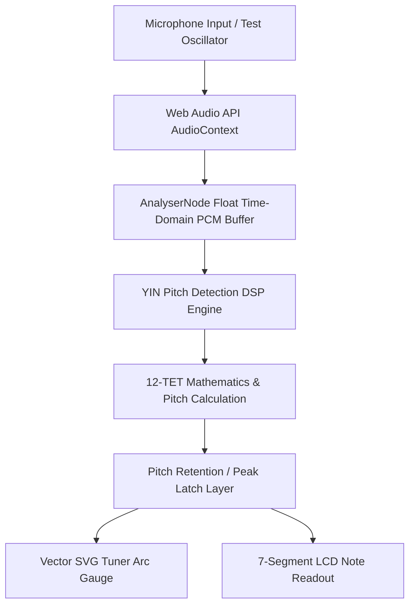
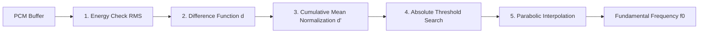

# Pitchly — Full Technical Documentation & Mathematical Theory

> **Pitchly: Real-Time Vocal & Instrument Live Pitch Detection Engine**  
> *Created by Kalidas & Elna*

---

## Table of Contents
1. [Executive Summary & System Architecture](#1-executive-summary--system-architecture)
2. [Acoustic Theory & 12-TET Mathematics](#2-acoustic-theory--12-tet-mathematics)
3. [Digital Signal Processing (DSP) & YIN Pitch Detection](#3-digital-signal-processing-dsp--yin-pitch-detection)
4. [Pitch Retention (Peak Latch / Piano Note Hold)](#4-pitch-retention-peak-latch--piano-note-hold)
5. [Vector SVG Geometry & Hydration Synchronization](#5-vector-svg-geometry--hydration-synchronization)
6. [UI & Industrial Design Architecture](#6-ui--industrial-design-architecture)
7. [Automated Verification & Unit Test Suite](#7-automated-verification--unit-test-suite)

---

## 1. Executive Summary & System Architecture

**Pitchly** is a high-precision, low-latency web application designed for real-time fundamental frequency ($f_0$) estimation, musical note identification, cents deviation measurement, and visual tuning assistance.



### Technical Stack
- **Frontend Framework**: Next.js (App Router), React, TypeScript
- **Styling & Layout**: Tailwind CSS, Custom Hardware Neumorphic & Metallic Shaders
- **Audio & DSP Core**: Web Audio API (`AudioContext`, `AnalyserNode`), YIN DSP Algorithm
- **Testing & Verification**: Vitest, Node.js Test Runner

---

## 2. Acoustic Theory & 12-TET Mathematics

### 2.1 Standard 12-Tone Equal Temperament (12-TET)
In 12-TET tuning, an octave is divided into 12 logarithmically equal semitones. The reference pitch is standard concert pitch:
$$A_4 = 440 \text{ Hz}$$
(Pitchly supports user-adjustable reference pitch $A_4 \in [430\text{ Hz}, 450\text{ Hz}]$).

### 2.2 Mathematical Formulas

#### 1. Frequency of $n$-th MIDI Note
Given a MIDI note number $n$ (where $A_4 = \text{MIDI Note } 69$):
$$f(n) = A_4 \cdot 2^{\frac{n - 69}{12}}$$

#### 2. MIDI Note Number from Frequency $f$
Given a detected fundamental frequency $f$ in Hz:
$$\text{exactMidi} = 69 + 12 \cdot \log_2\left(\frac{f}{A_4}\right)$$
$$n_{\text{midi}} = \text{Math.round}(\text{exactMidi})$$

#### 3. Note Name & Octave Derivation
- **Note Name**:
  $$\text{Note Index} = (n_{\text{midi}} \bmod 12 + 12) \bmod 12$$
  $$\text{Mapping: } [0 \to \text{C}, 1 \to \text{C\#}, 2 \to \text{D}, 3 \to \text{D\#}, 4 \to \text{E}, 5 \to \text{F}, 6 \to \text{F\#}, 7 \to \text{G}, 8 \to \text{G\#}, 9 \to \text{A}, 10 \to \text{A\#}, 11 \to \text{B}]$$
- **Octave Number**:
  $$\text{Octave} = \lfloor n_{\text{midi}} / 12 \rfloor - 1$$

#### 4. Exact Target Frequency $f_{\text{target}}$
The exact frequency of the nearest target semitone:
$$f_{\text{target}} = A_4 \cdot 2^{\frac{n_{\text{midi}} - 69}{12}}$$

#### 5. Cents Deviation ($cents$)
1 semitone consists of 100 cents. The cents deviation from $f_{\text{target}}$ is:
$$cents = 1200 \cdot \log_2\left(\frac{f}{f_{\text{target}}}\right)$$

- **Tuning Status Categories**:
  - **In Tune**: $|cents| \le 5$ cents
  - **Flat ($-$ )**: $cents < -5$ cents
  - **Sharp ($+$)**: $cents > +5$ cents

---

### 2.3 Step-by-Step Worked Numerical Example

**Problem**: A vocal or instrument pitch is detected at $f = 148.1 \text{ Hz}$ under reference $A_4 = 440 \text{ Hz}$. Calculate note name, octave, target frequency, and cents deviation.

1. **Calculate exact MIDI note**:
   $$\text{exactMidi} = 69 + 12 \cdot \log_2\left(\frac{148.1}{440}\right)$$
   $$\log_2\left(\frac{148.1}{440}\right) = \log_2(0.33659) \approx -1.57077$$
   $$\text{exactMidi} = 69 + 12 \cdot (-1.57077) = 69 - 18.8492 = 50.1508$$
   $$n_{\text{midi}} = \text{round}(50.1508) = 50$$

2. **Determine Note Name & Octave**:
   $$\text{Note Index} = 50 \bmod 12 = 2 \implies \mathbf{D}$$
   $$\text{Octave} = \lfloor 50 / 12 \rfloor - 1 = 4 - 1 = \mathbf{3} \quad (\mathbf{D3})$$

3. **Calculate Target Frequency**:
   $$f_{\text{target}} = 440 \cdot 2^{\frac{50 - 69}{12}} = 440 \cdot 2^{\frac{-19}{12}} \approx \mathbf{146.832 \text{ Hz}}$$

4. **Calculate Cents Deviation**:
   $$cents = 1200 \cdot \log_2\left(\frac{148.1}{146.832}\right) = 1200 \cdot \log_2(1.00863) \approx \mathbf{+14.9 \text{ cents}}$$

5. **Result Output**:
   $$\mathbf{148.1 \text{ Hz} \implies \text{D3} \implies \text{Target: } 146.83 \text{ Hz} \implies +14.9 \text{ cents (Sharp)}}$$

---

## 3. Digital Signal Processing (DSP) & YIN Pitch Detection

Pitchly uses the **YIN Algorithm** (de Cheveigné and Kawahara, 2002), recognized as one of the most accurate time-domain algorithms for fundamental pitch estimation of vocal and monophonic instruments.



### 3.1 YIN Algorithm Pipeline

#### Step 1: Signal RMS Energy Check
To filter out ambient room noise and silence before performing autocorrelation:
$$\text{RMS} = \sqrt{\frac{1}{W} \sum_{j=1}^{W} x[j]^2}$$
If $\text{RMS} < 0.005$, the frame is classified as unpitched ($\text{pitch} = -1$).

#### Step 2: Difference Function $d(\tau)$
Measures the difference between the signal $x$ and its time-lagged version $x(t+\tau)$:
$$d(\tau) = \sum_{j=1}^{W} (x[j] - x[j + \tau])^2$$
For lags $\tau \in [\tau_{\min}, \tau_{\max}]$, where $\tau_{\min} = \frac{\text{sampleRate}}{f_{\max}}$ and $\tau_{\max} = \frac{\text{sampleRate}}{f_{\min}}$.

#### Step 3: Cumulative Mean Normalized Difference Function $d'(\tau)$
Solves zero-lag harmonic multiplication errors:
$$d'(0) = 1$$
$$d'(\tau) = \frac{d(\tau)}{\frac{1}{\tau} \sum_{j=1}^{\tau} d(j)}$$

#### Step 4: Absolute Thresholding
Finds the smallest lag $\tau$ where $d'(\tau) < \text{threshold}$ (set to $0.15$). If no lag meets this criteria, the global minimum of $d'(\tau)$ within the lag window is selected.

#### Step 5: Sub-Sample Parabolic Interpolation
Fitting a parabola around $(\tau-1, \tau, \tau+1)$ to achieve sub-integer lag resolution:
$$\tau_{\text{refined}} = \tau + \frac{s_2 - s_0}{2 (2 s_1 - s_2 - s_0)}$$
where $s_0 = d'(\tau-1)$, $s_1 = d'(\tau)$, and $s_2 = d'(\tau+1)$.

#### Step 6: Pitch & Clarity Output
$$f_0 = \frac{\text{sampleRate}}{\tau_{\text{refined}}}$$
$$\text{Clarity} = 1 - d'(\tau_{\text{refined}})$$

---

## 4. Pitch Retention (Peak Latch / Piano Note Hold)

### The Problem
When playing acoustic instruments or piano, notes decay rapidly after key release. Standard real-time pitch detectors immediately drop to `--` or `0 Hz`, preventing musicians from inspecting pitch accuracy after hitting a note.

### The Solution: Latch Architecture
Pitchly implements a **Peak Latch State Machine**:

```ts
if (activeSource !== 'off' && pitchDetails.frequency > 0 && clarity > 0.45) {
  setLastDetectedPitch(pitchDetails);
  setIsLiveSignal(true);
} else {
  setIsLiveSignal(false);
}
```

- **Live Attack**: While note is sounding, live pitch updates at 60 FPS.
- **Release Hold**: When note dies out, the tuner retains $lastDetectedPitch$ on screen (`LAST NOTE HELD` indicator).
- **New Key Update**: As soon as a new key is played, the held note is automatically cleared and replaced with the new pitch.

---

## 5. Vector SVG Geometry & Hydration Synchronization

### 5.1 Vector Geometry Transformation
The needle is rendered directly inside SVG coordinate space $\text{viewBox} = (0, 0, 200, 100)$ centered at pivot $(100, 88)$:

$$\theta = \left(\frac{cents}{50} \cdot 60 - 90\right) \cdot \frac{\pi}{180} \text{ radians}$$
$$X_2 = 100 + R_{\text{needle}} \cdot \cos(\theta)$$
$$Y_2 = 88 + R_{\text{needle}} \cdot \sin(\theta)$$

where $R_{\text{needle}} = 72$.

### 5.2 Hydration Mismatch Resolution
To prevent Node.js SSR stringifier floating-point discrepancies ($50.952441518491995$ vs $50.95244151849199$) from causing React hydration mismatch warnings:

```ts
const x1 = Number((100 + innerR * Math.cos(angleRad)).toFixed(3));
const y1 = Number((88 + innerR * Math.sin(angleRad)).toFixed(3));
const x2 = Number((100 + outerR * Math.cos(angleRad)).toFixed(3));
const y2 = Number((88 + outerR * Math.sin(angleRad)).toFixed(3));
```

Rounding SVG coordinates to 3 decimal places ensures 100% deterministic, byte-for-byte identical markup across SSR HTML generation and client hydration.

---

## 6. UI & Industrial Design Architecture

Pitchly's interface is inspired by high-end analog/digital music hardware (**Boss Pocket GT & Boss GT-200 Graphic Tuner**):

- **Left Pedal Unit (`Pitchly GT`)**:
  - Metallic Value Rotary Knob for $A_4$ Reference Pitch adjustment.
  - Perforated Speaker Dot Matrix RMS input level meter.
  - Test Tone Generator with instant frequency presets ($148.1\text{ Hz D3}$, $146.83\text{ Hz D3}$, $440\text{ Hz A4}$, $261.63\text{ Hz C4}$).
- **Right Pedal Unit (`Pitchly GT-200`)**:
  - High-precision SVG Arc Needle Tuner Gauge.
  - Retro 7-Segment White/Cyan LCD display for note, octave, frequency, target Hz, and cents.
  - Chrome Heavy-Duty Footswitch button with mint-green LED for Microphone toggle.
- **Credits**: Screen-printed label at bottom right: `MADE BY 2 DUMB PEOPLE KALIDAS & ELNA`.

---

## 7. Automated Verification & Unit Test Suite

Pitchly includes automated unit tests (`vitest`) verifying math and DSP logic:

```bash
npm test
```

### Test Cases Covered
1. **$A_4$ Reference Pitch**: Verifies $440\text{ Hz} \implies \text{A4 (MIDI 69)}, 440\text{ Hz target}, 0\text{ cents}$.
2. **Prompt Example**: Verifies $148.1\text{ Hz} \implies \text{D3}, 146.83\text{ Hz target}, +14.9\text{ cents (Sharp)}$.
3. **Flat Pitch Deviation**: Verifies $145.5\text{ Hz} \implies \text{D3}, \text{cents} < 0\text{ (Flat)}$.
4. **Sine Wave DSP Pitch Detection**: Verifies YIN algorithm accuracy on $440\text{ Hz}$ and $146.83\text{ Hz}$ synthetic waveforms.
5. **Silence Noise Floor Rejection**: Verifies zero buffer returns unpitched state ($\text{pitch} = -1$).
